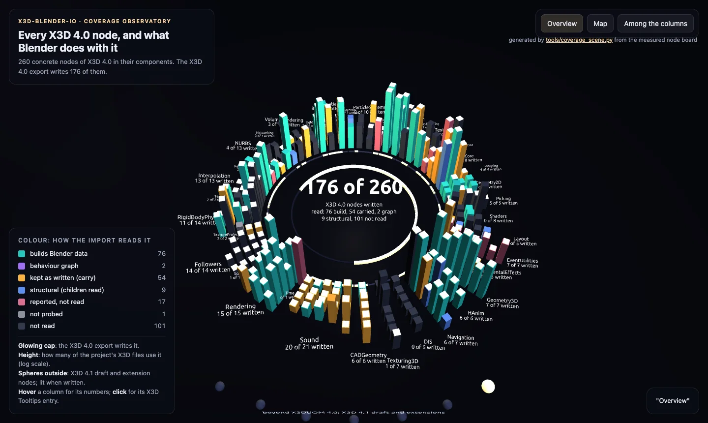
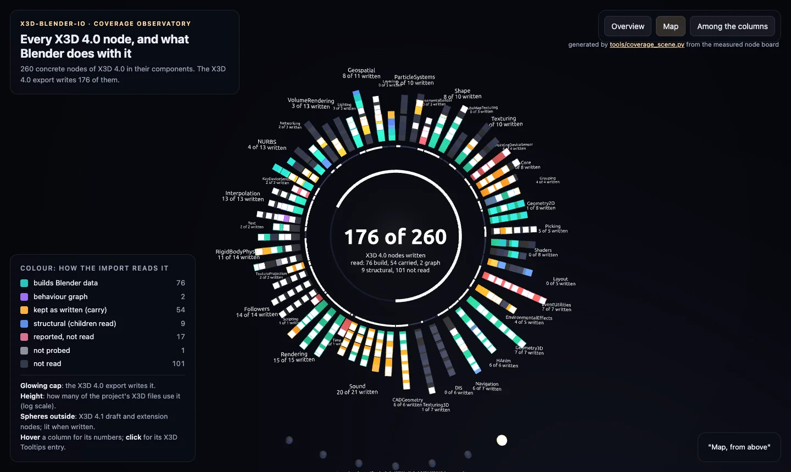
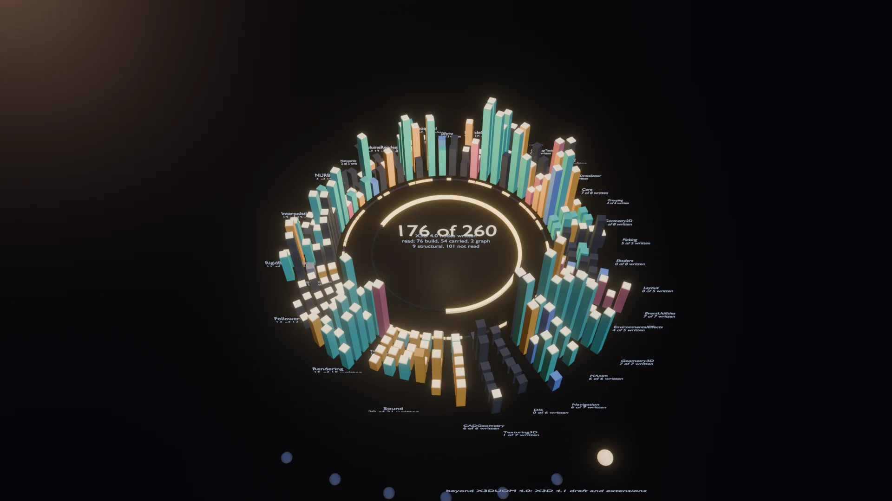

# Coverage observatory

The node board ([docs/NODE_BOARD.md](../NODE_BOARD.md)) as an X3D 4.0 scene: every concrete node of X3D 4.0 and what this add-on does with it, around a core that shows the totals. Open `index.html` from any static server (X_ITE 16.7.0 loads from jsDelivr):

```sh
cd docs/coverage && python3 -m http.server 8000     # then http://localhost:8000/
```



## How to read it

| What you see | What it means | Source |
|---|---|---|
| A column | one of the 260 concrete nodes of X3DUOM 4.0, in the sector of its component | `tools/node_board_nodes.json` |
| Its colour | how the import reads the node: builds Blender data, behaviour graph, kept as written (carry), structural, reported, not probed, not read | the board's read rung, `tools/node_board_measured.json` |
| A glowing cap | the X3D 4.0 export writes it (observed in an XSD-validated export run) | the board's written rung |
| Its height | how many of the project's 1451 X3D files use it, log scale | `tools/node_board_frequency.json` |
| The gold arc under a sector | the share of that component the export writes | the same |
| The core | the totals, and a ring filled to the written share | the same |
| Spheres outside | the seven X3D 4.1 draft or Web3D extension nodes x3d.py declares beyond X3DUOM 4.0, lit when written (GaussianSplats) | `mapping/x3d_fields.json` |

Hover a column for its name, component, level, rung and use count; click it for its entry in the Web3D X3D Tooltips. The buttons switch between three viewpoints: Overview, Map (from above) and Among the columns.



## Rendered by the add-on itself

The scene is plain X3D 4.0, so this add-on can import it. `img/blender-render.webp` is that import in Blender 5.3.0: 558 objects (513 meshes, all 39 labels as text objects, the three viewpoints as cameras, the three lights), rendered with Eevee from the Overview camera, AgX, and a Bloom glare in the compositor. Two things differ from X_ITE, both expected: Blender has no Billboard, so the labels stand upright instead of turning to the camera, and the hover and click behaviour of the Anchors is not part of a render.



## Regenerating

The scene is generated, never edited. After the board is re-measured (`tools/node_board_probe.py`, then `tools/node_board.py --write`):

```sh
python3 tools/coverage_scene.py            # rewrites docs/coverage/node-board.x3d
python3 tools/coverage_scene.py --check    # exits 1 when it is stale; tests/test_coverage_scene.py runs this
```

The output is deterministic, so `--check` is a byte comparison.

## Checked (2026-11-28)

- `node-board.x3d` validates against x3d-4.0.xsd (lxml) and passes the x3d_mcp validator fork's semantic check with 0 errors and 0 warnings (45 infos, unused DEFs on the groups that are there as handles).
- X_ITE 16.7.0 in headless Chromium (SwiftShader): all three viewpoint buttons bind, 0 page errors; the legend's counts, read from the scene's own column descriptions, equal the board's (76 builds, 2 graph, 54 carried, 9 structural, 17 reported, 1 not probed, 101 not read; 176 written).
- `tests/test_coverage_scene.py`: the scene is current, holds each node once, and every column's colour, cap and link agree with the board.
- Not checked: phones, Safari, and other X3D browsers.
